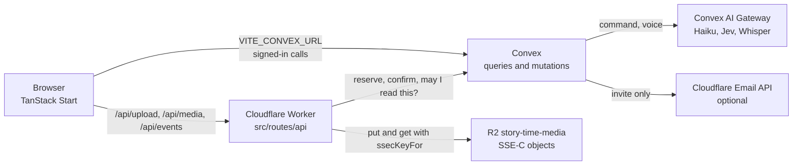
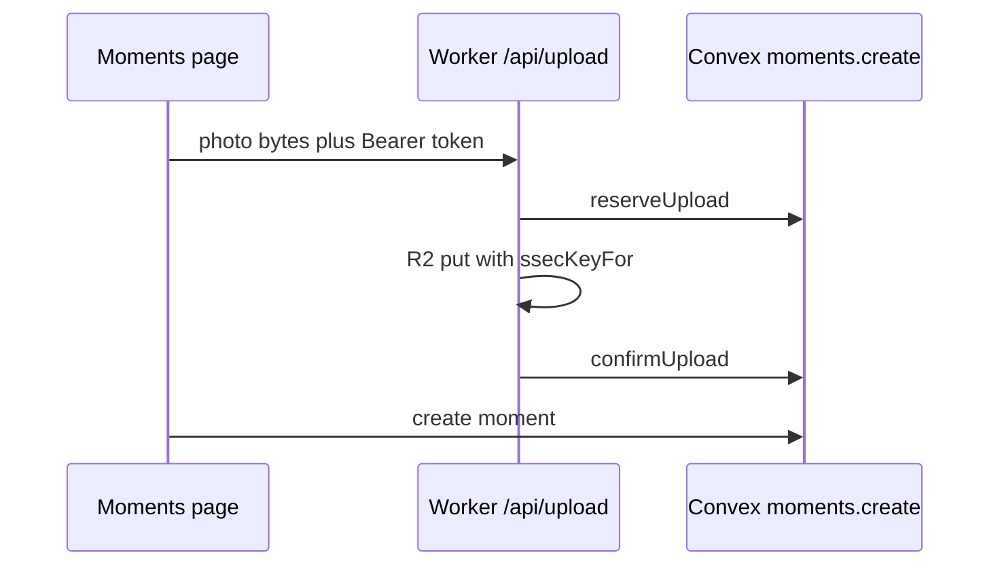

# How Story-time is wired

A map of the running app: what each piece is, which file owns it, and how a photo becomes a moment. For someone using the screens, see [user-guide.md](user-guide.md). This describes the code on `master`.

## Stack

The browser talks to two backends.

| Piece              | What it is                                                                                                                                                                                                                                | Where it lives                                                        |
| ------------------ | ----------------------------------------------------------------------------------------------------------------------------------------------------------------------------------------------------------------------------------------- | --------------------------------------------------------------------- |
| App                | React 19, TanStack Router and TanStack Start. SSR is off. The Worker renders the HTML shell and `<head>` only.                                                                                                                            | `src/start.ts` (`defaultSsr: false`), `src/router.tsx`, `src/routes/` |
| Build              | Vite, driven by `vp` (`vite-plus`). Tailwind 4. The Cloudflare Vite plugin targets the SSR environment.                                                                                                                                   | `vite.config.ts`, `package.json` scripts                              |
| Host               | Cloudflare Workers. The Worker entry is TanStack Start's server entry.                                                                                                                                                                    | `wrangler.jsonc`                                                      |
| Data and functions | Convex. Every public function is a typed API. Queries subscribe, so an open page updates when the data changes. Written in `convex/model/`, exposed by the re-export files in `convex/api/`; see [convex/README.md](../convex/README.md). | `convex/`                                                             |
| Photos and videos  | Cloudflare R2, bucket `story-time-media`, binding `MEDIA`. Objects are SSE-C.                                                                                                                                                             | `wrangler.jsonc`, `src/server/r2.ts`, `src/routes/api/`               |
| Sign-in            | Convex Auth, GitHub and Google. Access tokens last 15 minutes so a long upload can still be confirmed.                                                                                                                                    | `convex/auth.ts`, `convex/auth.config.ts`, `convex/convex.config.ts`  |

`src/router.tsx` builds one `ConvexReactClient` from `VITE_CONVEX_URL` and wraps the tree in `ConvexAuthProvider`. Signed-in pages sit under `src/routes/_app.tsx`, which sends an anonymous visitor to `SignInScreen` and a person who just signed out back to `/`.

There is no separate Node server. Worker routes under `src/routes/api/` are the only place that touches R2. Convex cannot hold the R2 binding, so it reserves a row and the Worker writes the bytes.



## Auth and who may touch a trip

Sign-in is OAuth only. `convex/auth.ts` wires GitHub and Google and, for a dev build, anonymous sign-in. `createGithubUser` and `createGoogleUser` in `convex/model/users.ts` insert a `users` row with the provider's verified email, and `saveOauthProfile` then runs on every sign-in: it fills an empty display name from the provider's name and saves the address of the provider's photo (`imageUrl`). An uploaded image (`imageMediaId`) is shown instead of it. A typed email in Settings is stored and is not a login.

The Convex auth config (`convex/auth.config.ts`) trusts JWTs from that deployment's site URL. `requireUserId` and `requireEventAccess` in `convex/lib/access.ts` are the gate. The signed-in user id is the JWT subject. A missing trip and a trip you cannot see both throw `Event not found`, so an id cannot be probed.

Roles, highest first: owner, contributor, viewer. The owner is `events.ownerId`. Everyone else has a row in `sessions` (`convex/model/sessions.ts`). A revoked session grants nothing. `assertNotArchived` blocks writes on an archived experience.

A share link is not a user. `convex/model/share.ts` `eventFor` hashes the token, finds the experience, and returns null for a bad, unknown, or disabled token. The token travels in the URL fragment and, for pictures, as `Authorization: Share …` (`shareToken` in `src/server/r2.ts`).

## Data model

`convex/schema.ts` is the source of truth. Sensitive fields use `vEncrypted` (`iv`, `ct`, `v`).

| Table      | Role                                                                                                                                                                                           |
| ---------- | ---------------------------------------------------------------------------------------------------------------------------------------------------------------------------------------------- |
| `users`    | Display name, username, optional email, avatar media id.                                                                                                                                       |
| `events`   | A trip. Owner, title, dates, status (`draft`, `active`, `archived`), visibility, share key and encrypted share token, `momentCount`, `keyVersion`. Title is plain text and has a search index. |
| `moments`  | One stop-by-stop memory. Time, encrypted place and geo, blocks (photo, video, link, note, feeling), transport, extra stops, labels. Indexed by `eventId` + `startsAt`.                         |
| `media`    | One upload. R2 key, size, mime, status (`reserved`, `ready`, `deleted`), purpose (`avatar` when set), moment id when attached.                                                                 |
| `sessions` | Invite grants: user, experience, role, `revokedAt`.                                                                                                                                            |
| `changes`  | The Activity log. Names the field that changed, not the secret.                                                                                                                                |

Convex components have their own tables: invite tokens (`convex/components/invites`), the email outbox (the `@sarant/cloudflare-email-component` package), three aggregates for counts and byte totals (`convex/lib/aggregates.ts`), plus the auth (core, GitHub, Google, anonymous) and rate-limiter components mounted in `convex/convex.config.ts`.

These tables are still in the schema and are not part of the product. Nothing in the app writes them. `purgeEventData` in `convex/model/events.ts` deletes per-experience rows when a trip is removed. Account-wide `agentTokens` (no `eventId`) stay until that cleanup is done by hand:

- `itinerary`
- `canvases` and `canvasNodes`
- `quotaRequests`
- `agentTokens`

`convex/http.ts` mounts no routes of ours. Sign-in HTTP routes come from the auth components. There is no MCP server in the tree.

## Moment creation

Two ways in, one write.

Photos go through `src/lib/add-photos.ts` and `src/lib/upload.ts`. The Worker reserves a `media` row, stores the bytes, then confirms. `api.moments.create` in `convex/model/moments.ts` attaches those ids to a new moment. Words typed with the photos become the first note.

A sentence goes through `CommandBar` (`src/components/event/command-bar.tsx`). If Jev calls it new, the client calls `moments.create` immediately. A change waits for Apply, which calls `api.ai.command.apply`.

`createMoment` in `convex/model/moments.ts` is the shared insert. It checks the 300-moment cap (`MOMENT_LIMIT` in `convex/lib/limits.ts`), encrypts place, geo, notes, and labels, bumps `momentCount`, and writes a `changes` row.



## Sharing

`src/routes/_app/e.$id.shared.tsx` renders `src/components/event/shared-tab.tsx`.

The public link is `share.enable`, `share.disable`, and `share.rotate` in `convex/model/share.ts`. The stored lookup is a hash (`shareKey`). The token itself is encrypted so the owner can copy it again. The URL is `origin + /s#token`.

`src/routes/s.{-$name}.tsx` reads the fragment, calls `share.get` (the trip and moments, no author names), and renders the scrolling story (`StoryScroll`). **Play** mounts `StoryPlayer`, unless the owner switched the film off.

Invites are `convex/model/invites.ts` plus `convex/components/invites`. The owner gets a one-time link (`/invite#token`). Accepting it writes a `sessions` row. Optional email is below.

## Play

`src/routes/e.$id.story.tsx` is the signed-in player. The search params are `step`, `momentId`, and `mode` (`read`, `film`).

`mode=read` is the scrolling story (`src/components/story/story-scroll.tsx`). `mode=film` is `src/components/story/story-player.tsx`. Closing the film returns to the story. **Play from here** on the moments page (`src/routes/_app/e.$id.index.tsx`) links here with the moment id.

## The command bar and the AI pipeline

The box is `src/components/event/command-bar.tsx`. It is not an MCP client. `convex/http.ts` is empty of our routes, and nothing reads `agentTokens` to sign a request in.

`api.ai.command.propose` (`convex/model/ai/command.ts`):

1. `internal.model.ai.command.read` loads the trip for the signed-in contributor.
2. `takeAi` takes one of the person's ten AI uses for the day (`convex/lib/rateLimit.ts`). If Haiku can't plan, `creditAi` gives it back.
3. Jev (`typesafe/jev-1.13`, `jevModel` in `convex/lib/ai/models.ts`) labels the sentence new, change, remove, or unclear.
4. A new sentence returns `{ kind: "new" }`. The client saves a note moment. No plan.
5. Otherwise Haiku (`anthropic/claude-haiku-5.5`, `scribeModel`) plans with one AI SDK call (`generateStructured` in `convex/lib/ai/generate.ts`). Instructions are the `INSTRUCTIONS` string in `command.ts`. Nothing is stored: there is no thread, message history or tool loop.
6. `resolvePlan` drops removals unless `allowsRemoval` says the sentence asked for one. At most 8 operations (`MAX_COMMAND_OPS`).

`api.ai.command.apply` writes those operations in one transaction or not at all. New moments go through `createMoment`. The client deletes any R2 objects the mutation reports as removed.

Voice is separate: `api.ai.voice.transcribe` (`convex/model/ai/voice.ts`), Whisper `openai/whisper-large-v3-turbo`, drawing on the same ten uses and giving one back when the transcription fails. It fills the box. It does not save.

Nothing else calls AI. Added photos are grouped into moments and their places named from GPS without it, and a moment's note is only what a person wrote.

Models are called through the Convex AI Gateway (`convex/lib/ai/models.ts`). No provider key is stored in this repo. Propose fails soft or returns `AI_UNAVAILABLE`.

## Encryption and keys

One secret, `ENCRYPTION_MASTER_KEY`, base64 of 32 bytes. It must be the same value on the Convex deployment and on the Worker. Two HKDF salts keep the keys apart.

| Use                                           | Code                                                 | Salt              | Label                                         |
| --------------------------------------------- | ---------------------------------------------------- | ----------------- | --------------------------------------------- |
| Notes, places, coordinates, labels, link text | `encryptText` / `eventKey` in `convex/lib/crypto.ts` | `storytime/event` | `eventId:keyVersion`                          |
| R2 objects                                    | `ssecKeyFor` in `src/server/r2.ts`                   | `storytime/r2`    | `eventId:version`, or `avatar:userId:version` |

AES-GCM IVs are random. The per-experience key is derived when needed and is not stored. Bumping `events.keyVersion` changes later field encryptions. It does not re-encrypt old rows by itself, and it does not change an object already written to R2 under the previous version. Each `media` row keeps the `keyVersion` it was stored with.

`readText` still accepts a plain string for a description saved before encryption. `migrations.encryptPlainText` in `convex/model/migrations.ts` is the one-off that walks those rows. It is not a cron.

What stays in the clear: experience title, times, transport, media ids, R2 keys, mime types. Share queries decrypt for the token holder and then return the words. Photo bytes are not inside the AES-GCM ciphertext. They are authorized and then streamed. A share link is allowed to receive them. See [user-guide.md](user-guide.md) for the check you can do in the browser and in the bucket.

## Media upload and serving

`src/lib/upload.ts` POSTs to `/api/upload` (`src/routes/api/upload.ts`).

1. The Worker checks the bearer token and a coarse size cap.
2. `media.reserveUpload` or `media.reserveAvatarUpload` (`convex/model/media.ts`) checks membership, mime, the per-experience caps (150 photos, 5 videos), and the 1 GB per-person cap (all in `convex/lib/limits.ts`). It inserts `status: "reserved"` and returns `r2Key`, `keyVersion`, and `keyScope`.
3. The Worker writes the body with `FixedLengthStream` so the declared size is the real size, and `ssecKey` from `ssecKeyFor`.
4. `media.confirmUpload` sets `status: "ready"`.

If confirm never happens, `sweepReservedUploads` (hourly, `convex/crons.ts`) drops stale reservations so they stop counting toward the cap.

Serving is `GET /api/media/$id` (`src/routes/api/media.$id.ts`). A bearer token calls `media.getForDownload`. A share token calls `share.mediaForShare`. Either returns the R2 key and the scope, or null. The Worker then `MEDIA.get` with the same SSE-C key. The response is `private, no-store`. The browser keeps a `blob:` URL in `src/lib/use-media-url.ts` (at most 40). There is no public R2 URL and no presigned link.

Delete of a trip is `DELETE /api/events/$id` (`src/routes/api/events.$id.ts`): list keys, delete the R2 objects, then `events.remove`, which schedules `purgeEventData`. Replacing a single photo deletes that object from the media route's DELETE handler.

`getForDownload` hides a detached photo from everyone except the uploader.

## Email

Only invites send mail. `invites.create` calls `queueMail` (`convex/lib/emailAddress.ts`) when `CF_ACCOUNT_ID`, `CF_EMAIL_TOKEN`, and `EMAIL_FROM` are all set and the owner typed an address. Otherwise it returns the link and `emailed: false`.

`queueMail` queues the message in the email component and schedules `convex/model/mail.ts` `deliver`, which sends it through Cloudflare's email sending API, blanks the stored body, and logs how many addresses were delivered, bounced or suppressed. The `inviteEmail` rate limit allows 10 invite emails per person a day. No other mail is implemented. There is no browser push. Toasts are `sonner`, mounted in `src/routes/__root.tsx`. Activity is `convex/model/changes.ts` `listForEvent`, shown by `src/routes/_app/e.$id.activity.tsx`.

## Rate limits and other caps

| Name                               | Where                     | Amount                                          |
| ---------------------------------- | ------------------------- | ----------------------------------------------- |
| `ai` (the box and voice)           | `convex/lib/rateLimit.ts` | 10 a day per person, back at midnight UTC       |
| Invite, share, confirmation emails | `convex/lib/rateLimit.ts` | 10, 10 and 5 a day                              |
| Waiting invites                    | same                      | 50 per experience                               |
| Moments, media, bytes              | `convex/lib/limits.ts`    | See the table in [user-guide.md](user-guide.md) |

Invite expiry has a daily cron as a backstop (`convex/crons.ts`, 03:17 UTC) plus a timer on the invite itself.

## What leaves the app

- The box and voice send the sentence (with the trip's moments for context) or the recording to the Convex AI Gateway. Nothing is kept there, and the app works without it. Details in [The command bar and the AI pipeline](#the-command-bar-and-the-ai-pipeline).
- Place search and photo location names send the typed text or the photo's coordinates to photon.komoot.io (OpenStreetMap).
- Story legs by foot, bike, car, bus or train ask OpenStreetMap's public routers (routing.openstreetmap.de, routing.openrailrouting.org) for a route from the viewer's browser. Only the two stops are sent, rounded to about 100 m, and answers stay in memory. Without a router the leg is a curve.

## Environment

Convex deployment (set with the Convex CLI, not committed):

| Name                                                 | Required       | Used for                                                                                                                        |
| ---------------------------------------------------- | -------------- | ------------------------------------------------------------------------------------------------------------------------------- |
| `AUTH_PRIVATE_KEY`, `AUTH_JWKS`                      | yes            | Session signing.                                                                                                                |
| `AUTH_GITHUB_CLIENT_ID`, `AUTH_GITHUB_CLIENT_SECRET` | yes            | GitHub sign-in.                                                                                                                 |
| `AUTH_GOOGLE_CLIENT_ID`, `AUTH_GOOGLE_CLIENT_SECRET` | yes            | Google sign-in.                                                                                                                 |
| `ENCRYPTION_MASTER_KEY`                              | yes            | Field encryption and, the same value, R2 SSE-C.                                                                                 |
| `APP_URL`                                            | for real links | Invite and share links, allowed OAuth redirects. Comma-separated. Unset means `http://localhost:3000` (`convex/lib/appUrl.ts`). |
| `ALLOW_ANONYMOUS_SIGNIN`                             | no             | The string `true` allows the dev anonymous button. Leave unset in production.                                                   |
| `CF_ACCOUNT_ID`, `CF_EMAIL_TOKEN`, `EMAIL_FROM`      | no             | Invite email. Without them, invites are links only.                                                                             |

Worker (`.dev.vars` locally, a secret in production):

| Name                    | Used for                                                                           |
| ----------------------- | ---------------------------------------------------------------------------------- |
| `ENCRYPTION_MASTER_KEY` | Must match Convex. `ssecKeyFor` reads it. `.dev.vars.example` lists the name only. |

Browser build:

| Name              | Used for                                                                     |
| ----------------- | ---------------------------------------------------------------------------- |
| `VITE_CONVEX_URL` | Written by `convex dev`. The client in `src/router.tsx`.                     |
| `VITE_APP_URL`    | Absolute `og:image` at build time (`vite.config.ts` warns if it is missing). |

The AI gateway uses the Convex deployment's own billing. This repo has no model-provider secret.

## Local development

```bash
pnpm install
cp .dev.vars.example .dev.vars   # set ENCRYPTION_MASTER_KEY
pnpm dev                         # convex dev, and the app on http://localhost:3000
```

`pnpm dev` is `convex dev --start 'vp dev --port 3000'`. `pnpm dev:web` is the app only. `pnpm test` is Vitest. `pnpm typecheck` is `tsc --noEmit`. `pnpm lint` is ESLint. `pnpm build` is `vp build`.

Auth keys for a new Convex dev deployment come from `pnpm dlx @convex-dev/auth`, which sets `AUTH_PRIVATE_KEY` and `AUTH_JWKS` and leaves `convex/` alone. Do not set `ALLOW_ANONYMOUS_SIGNIN` on a deployment that other people can reach.

Other scripts: `pnpm preview` serves the build, `pnpm generate-routes` regenerates `src/routeTree.gen.ts`, `pnpm typegen` regenerates `worker-configuration.d.ts` from `wrangler.jsonc`.

`postinstall` copies the MapLibre worker into `public/` and generates Worker types from the example env file.

## Tests

Vitest (`vitest.config.ts`) uses the edge-runtime environment and includes `convex/**/*.test.ts` and `src/**/*.test.ts`. There is no Playwright suite.

Convex tests use `convex-test`. They register the email and invites components where a test touches them. Representative files:

| File                                                    | What it holds still                                                             |
| ------------------------------------------------------- | ------------------------------------------------------------------------------- |
| `convex/tests/share.test.ts`                            | Link on and off, what it shows, pictures only from a moment of that experience. |
| `convex/tests/moment-actions.test.ts`                   | Coordinates stored as `iv` / `ct`, not as the raw numbers.                      |
| `convex/tests/command.test.ts`                          | Plans and apply.                                                                |
| `convex/tests/invites.test.ts`                          | Email only when the Cloudflare vars are present, and the daily cap.             |
| `convex/tests/ai.test.ts`, `convex/tests/voice.test.ts` | The AI allowance and transcription helpers.                                     |

No test performs a real R2 GET with and without the SSE-C key.

## Deploy and CI

First deploy, in order:

1. `pnpm exec convex deploy` (so the schema and functions match), then set the production env above with `pnpm exec convex env set NAME value --prod`, including `APP_URL` and the same `ENCRYPTION_MASTER_KEY`.
2. Point the Google and GitHub apps at `https://<deployment>.convex.site/oauth/google/callback` and `.../oauth/github/callback`.
3. `pnpm exec wrangler r2 bucket create story-time-media` (bound as `MEDIA`).
4. `pnpm exec wrangler secret put ENCRYPTION_MASTER_KEY`, the same value Convex has.
5. Build with `VITE_CONVEX_URL` and `VITE_APP_URL`, then `pnpm exec wrangler deploy`.

Cloudflare Workers Builds settings (Settings → Build):

- Build command:
  ```bash
  if [ "$WORKERS_CI_BRANCH" = "master" ]; then WORKERS_CI_BRANCH=main pnpm exec convex deploy --yes --cmd "pnpm build" --cmd-url-env-var-name VITE_CONVEX_URL; else VITE_CONVEX_URL=https://<dev deployment>.convex.cloud pnpm build; fi
  ```
  `master` deploys Convex and the site. Other branches build against dev and leave Convex alone. `WORKERS_CI_BRANCH=main` is there because the Convex CLI treats only a branch named `main` as production on Cloudflare (`isNonProdBuildEnvironment` in `convex/src/cli/lib/envvars.ts`).
- Deploy command: `pnpm exec wrangler deploy`. Preview command: `pnpm exec wrangler preview`.
- Build variables (not the runtime ones, which the build cannot see): `CONVEX_DEPLOY_KEY` (a `prod:` key), `PNPM_VERSION=12.6.0`, `VITE_APP_URL`.
- Preview URLs talk to the dev deployment, where sign-in returns to localhost, so sign-in does not work there. Their runtime `ENCRYPTION_MASTER_KEY` and `MEDIA` binding are set on the Previews Base tab.

What GitHub actually runs today:

- `.github/workflows/checks.yml` runs `pnpm typecheck`, `pnpm lint` and `pnpm test` on every pull request and on pushes to `master`. It does not build or deploy.
- Cloudflare **Workers Builds** is attached to the `story-time` Worker with the settings above. It failed on every pull request until 2026-10-18, first because `CONVEX_DEPLOY_KEY` was a runtime secret instead of a build variable, then because of the `main` check.
- **Entire Gates** posts a failing check. There is no Entire config in the repo. That check has not been a required status, because pull requests have merged while it was red.

The Checks workflow only blocks a merge once it is marked as a required status check in the GitHub branch protection for `master`.

## File index

```
src/routes/              pages. _app/ is signed in. api/ is the Worker. s.{-$name}.tsx is the share link. e.$id.story.tsx is Play.
src/components/event/    moments, the command bar, invites
src/components/story/    the film and the scrolling story
src/server/r2.ts         SSE-C keys and the Convex HTTP client the Worker uses
src/lib/                 upload, media blob cache, time, maps
convex/schema.ts         tables
convex/model/moments.ts        create and edit
convex/model/share.ts          the public link
convex/model/media.ts          reserve, confirm, download rights
convex/model/ai/               command, voice
convex/lib/              access, crypto, limits, rate limits
convex/components/       email and invites
convex/tests/            convex-test
docs/user-guide.md       the same system, as a person uses it
```
